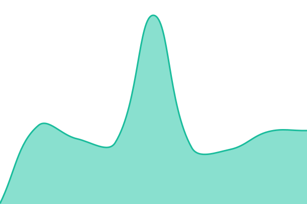

# [📈 Live Status](https://brilliantnodes.github.io/status): <!--live status--> **🟩 All systems operational**

This repository contains the open-source uptime monitor and status page for [brilliantnodes](https://brilliantnodes.github.io/status), powered by [Upptime](https://github.com/upptime/upptime).

With [Upptime](https://upptime.js.org), you can get your own unlimited and free uptime monitor and status page, powered entirely by a GitHub repository. We use [Issues](https://github.com/brilliantnodes/status/issues) as incident reports, [Actions](https://github.com/brilliantnodes/status/actions) as uptime monitors, and [Pages](https://brilliantnodes.github.io/status) for the status page.

<!--start: status pages-->
<!-- This summary is generated by Upptime (https://github.com/upptime/upptime) -->
<!-- Do not edit this manually, your changes will be overwritten -->
<!-- prettier-ignore -->
| URL | Status | History | Response Time | Uptime |
| --- | ------ | ------- | ------------- | ------ |
|  [Brilliant Nodes website](https://brilliantnodes.com) | 🟩 Up | [brilliant-nodes-website.yml](https://github.com/brilliantnodes/status/commits/HEAD/history/brilliant-nodes-website.yml) | 

 226ms
     
 | 

<a href="https://brilliantnodes.github.io/status/history/brilliant-nodes-website">97.95%</a>
    

|  gno.land Onyx node (testnet) | 🟩 Up | [gno-land-onyx-node-testnet.yml](https://github.com/brilliantnodes/status/commits/HEAD/history/gno-land-onyx-node-testnet.yml) | 

 198ms
     
 | 

<a href="https://brilliantnodes.github.io/status/history/gno-land-onyx-node-testnet">100.00%</a>
    

|  Gnosis Chain full node | 🟩 Up | [gnosis-chain-full-node.yml](https://github.com/brilliantnodes/status/commits/HEAD/history/gnosis-chain-full-node.yml) | 

 158ms
     
 | 

<a href="https://brilliantnodes.github.io/status/history/gnosis-chain-full-node">100.00%</a>
    

<!--end: status pages-->

[**Visit our status website →**](https://brilliantnodes.github.io/status)

## 📄 License

- Powered by: [Upptime](https://github.com/upptime/upptime)
- Code: [MIT](./LICENSE) © [Anand Chowdhary](https://anandchowdhary.com)
- Data in the `./history` directory: [Open Database License](https://opendatacommons.org/licenses/odbl/1-0/)
